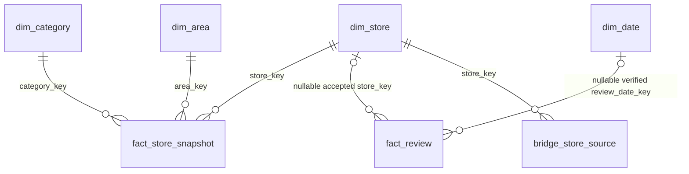

# F&B Dimensional Modeling — Analytics MVP

**BRD v1.5 Draft.** The base warehouse and pinned demographic/market handoff have passed actual execution. The business dashboard extends their serving views with thin read-only queries; it does not rebuild Gold or introduce new business facts. Runtime artifacts remain the authority for deployment sign-off.

Method reference: the operator-provided `23120298.PhamQuangMinh (1).pdf`, “BT#2: MODELING LOGISTIC”, 31 PDF pages; SHA256 `ccffc4e441add2142d2081fa8ac0bc54e1bafcdee655b11ac84141897f79bc0f`. Relevant PDF pages: 2–9 process/grain/dimensions, 9–20 measures/fact types/galaxy/KPI validation, 28–31 source-to-target mapping. The private reference is not redistributed. We reuse its reasoning sequence, not Logistics entities or example decisions. Unlike its special not-yet-occurred date member, absent review dates remain NULL as required here.

## 1. Business Questions

| Question | Business process / denominator |
|---|---|
| How many observed canonical records are in each area/category/status? | BP1; distinct catalog anchors in one selected Gold release |
| Where are they located, and which have accepted Google enrichment? | BP1; canonical coordinates and accepted source associations |
| How many observed catalog anchors per km² / 1,000 residents of the selected area? | BP1 numerator from current Gold; independent pinned provider reference denominator, not certified area/census or market completeness |
| What Google Place aggregate rating/count is available per accepted store? | BP1; valid fields from the exact pinned Places release, not collected review averages |
| How many logical reviews exist, which ratings do they have, and how do they vary over time? | BP2; each logical review once; time charts require verified publication dates |
| Which catalog anchors have at least one observed attached review? | BP1 with BP2 preaggregated to one store; observed review coverage, not complete Google review coverage |
| What remains unresolved, source-only, incomplete or unmatched? | DQ/audit reporting; no additional business process/fact |

## 2. Business Processes

**BP1 — Store Catalog Snapshot.** Publish a catalog state for one immutable Gold release. Keep 725 Overture anchors, source precedence/provenance and accepted attachments; an anchor is not independently verified physical-store truth. No cleaning/dedup/matching is repeated in analytics.

**BP2 — Customer Review Analytics.** Describe the current-known revision of each unique logical review from Gold's attached/unmatched partitions. Preserve the original typed Google identity even without an accepted canonical store. Repeated observations/collections are not new reviews.

ER quality/source reconciliation describe the integration process; they are audit views backed by admitted release controls, not a third business fact. Recommendation, sentiment, text analysis and ML are outside this implementation.

## 3. Grain Validation

| Relation | Grain / uniqueness | KPI and drill-down validation |
|---|---|---|
| `dim_store` | 1 current canonical store; unique original canonical ID | Descriptive drill-down without joining source/review rows into store counts |
| `dim_category` | 1 analytical category business key | Category grouping; Gold evidence remains on snapshot, not assumed by the dimension |
| `dim_area` | 1 supported area ID with source boundary evidence | Existing ward only; unsupported references fail the accounting gate rather than fabricate hierarchy |
| `dim_date` | 1 observed verified UTC publication calendar day | Year → quarter → month → day; use year+month together, not month alone across years |
| `fact_store_snapshot` | 1 `store_key × gold_release_id` | Count one anchor per selected release; never sum counts over releases |
| `fact_review` | 1 original `logical_review_id`; also unique `(source,source_review_id)` | One logical review across repeat collections; store/date may be NULL |
| `bridge_store_source` | 1 authoritative source association × Gold release | Source contributions at mapping grain, not additional stores |

Published logical IDs and canonical IDs are retained. Dimension surrogate keys are deterministic MD5 hashes of business keys; date keys are YYYYMMDD integers for real dates. PK/unique tests reject duplicates/collisions. Only one active warehouse version is exposed in BI. Archived versioned schemas are replay states, not extra business observations to UNION into a fact.

## 4. Dimensions

| Dimension | Business key → surrogate key | Attributes and source |
|---|---|---|
| `dim_store` | Gold `store_id` → `store_key`; original ID retained as `canonical_store_id` | Gold name, address, coordinates, identity status, human-verification flag, field provenance; current attributes, no SCD2 |
| `dim_category` | Existing mart `analysis_category` → `category_key` | Category key and readable name; unknown is an explicit category; no claim of verified taxonomy |
| `dim_area` | Existing `admin_area_id` → `area_key` | OSM boundary provenance plus one explicitly pinned demographic reference version/year for the supported ward; provider area/population remain separately named reference fields with source URL, basis, WARNING and release ID. `trusted_area_km2` remains NULL. No fabricated hierarchy or census |
| `dim_date` | UTC `published_at` date → `date_key` | full_date/day/month/quarter/year; admitted only when timestamp_status=VERIFIED; missing/ambiguous dates get no fabricated row |

Store is conformed across both facts. Category/area describe the selected store snapshot. Date is used only for the review publication date; first-seen/collection timestamps are not substitutes. Source `data_id` and `place_id` are preserved separately; a `data_id` is not relabelled as an official Google Place ID.

## 5. Facts & Measures

### BP1 — `fact_store_snapshot`

Keys: `store_key`, `category_key`, `area_key`, `gold_release_id`. Measures: `store_count=1`, accepted/source-only 0/1 flags, optional `google_rating`, optional `google_rating_count`. Evidence attributes include Gold canonical category/status, analytical-category basis/provenance, verification status and pinned Places release ID.

Google fields join only through Gold's published Google source mappings on typed identity. Valid Place ratings may contain decimals in [1,5]; count must be nonnegative. Missing/invalid fields remain NULL with status. Ratings on unaccepted Google candidates cannot enrich source-only stores. Acceptance remains unchanged when optional rating is absent.

### BP2 — `fact_review`

Fields: original logical/source review IDs, `google_id_kind`, `google_identity_value`, nullable accepted `store_key`, nullable `review_date_key`, optional `review_rating`, status/source of the date, `review_count=1`, source Reviews release and association Gold release.

Review stars are discrete 1–5; missing/out-of-domain values remain NULL/flagged while the review survives. Date derives only from verified `published_at`, in UTC. Gold association lineage and a hash of the original source provenance preserve traceability; reviewer names, review text and opaque raw diagnostics are not copied to the fact.

The canonical-store FK is NULL for unmatched reviews. All logical reviews still point to their original Google identity. A join to snapshot category/area additionally uses the association Gold release. A source-only catalog anchor is not an excuse to attach an unresolved Google review.

### Bridge and additivity

The bridge copies authoritative Gold mappings: 725 Overture anchor associations + 302 accepted Google associations = 1,027 rows. Non-accepted candidate pairs do not enter it. Decision source, policy, evidence hash and provenance remain available in the warehouse.

| Measure | Aggregation rule |
|---|---|
| store_count / link flags | Add across stores for one release; semi-additive across releases |
| review_count | Add across unique logical reviews, including unmatched/unknown-date buckets where applicable |
| review_rating | Non-additive; collected-review mean uses rated rows only, with rated count reported |
| Google Place rating/count | Store-snapshot fields; never substitute AVG(collected reviews), never call an unweighted AVG(store ratings) the mean of all Google reviews |
| review coverage | `100 × stores_with_at_least_one_attached_review / canonical_records`; calculated in PostgreSQL |
| attachment percentage | `100 × attached_logical_reviews / all_logical_reviews`; DQ metric, not market/source completeness |

No direct bridge→snapshot COUNT(*) join is used. `v_store_review_summary` preaggregates BP2 to one store before joining BP1.

## 6. Fact Types and Table Choices

- Store fact: **snapshot fact at the release boundary**; no fabricated daily cadence or accumulating lifecycle milestones.
- Review fact: **transaction grain / current-known logical review revision**; corrections replace the logical state through versioned refresh rather than append a collection duplicate.
- Bridge: source relationship, not a third business fact. `release_audit` is a technical load-control record, not a business process.
- Four dimensions support actual questions. No dim_rating (numeric measure), dim_reviewer (no reviewer question/PII requirement), sentiment fact, recommendation fact, SCD2, speculative hierarchy or duplicate aggregate-table family.
- Gold's 8-model/27-test build and existing 3 analytics marts are preserved. All 3 marts are copied from verified Parquet into the versioned serving schema; `mart_store_business` supplies the existing category projection. Seven new dimensional dbt models provide the missing grains; no Gold/dbt project is rewritten.

## 7. Star / Galaxy Schema



The two stars share the store dimension. Gold release IDs are degenerate snapshot/provenance keys; no extra dim_release is required for a one-active-release MVP. Measures from the two facts are aggregated at their own grains before comparison.

## 8. KPI Verification and Actual Status

Real pinned inputs: Gold `5d7915f7313e0da6dc10f1bb`, analytics `a833acfc5db7959f581354c1`, native Places `96815d7cf899140c08ace2d8`, native Reviews `da12735e7205df69b103ed5d`. Producer manifests, selected artifact SHA256 and lineage bind the handoff; no implicit latest input or source rerun.

| KPI | Definition / expected from Gold | Real read-only projection |
|---|---|---:|
| Canonical records | COUNT snapshot / SUM(store_count), one Gold release | 725 |
| Accepted / source-only | SUM of mutually exclusive flags | 302 / 423 |
| Published source mappings | COUNT bridge, at its own grain | 1,027 |
| Non-accepted pairs | Gold audit accounting, not a fact join | 174 (16 REVIEW_REQUIRED + 152 INSUFFICIENT_DATA + 6 NON_MATCH) |
| Logical reviews | COUNT fact_review | 10,139 |
| Attached / unmatched | store_key non-NULL / NULL | 6,942 / 3,197 |
| Gold category provisional / pending | Snapshot Gold evidence status, not analytical category | 267 / 458 |
| Valid Google rating/count on accepted stores | Non-NULL snapshot Google fields | 269 / 269; 33 accepted stores still lack these optional fields |
| Verified review dates / valid review stars | Non-NULL review_date_key / review_rating | 10,139 / 10,139 |

Production SQL derives expected values from the admitted Gold summary and audit artifacts, never literal pilot counts. DQ additionally exposes 182 AVAILABLE / 244 INCOMPLETE_METADATA / 34 MISSING_METADATA Places, missing addresses, taxonomy unknown and review-date/rating gaps.

Focused tests execute dbt models/data tests on synthetic inputs in the pinned warehouse Docker environment. Snapshot tests verify logical hashes, read-only access, GRID/DETAIL SQL, rollback before pointer publication and retained readers during refresh. Real pilot evidence is summarized below; it is separate from the public synthetic Demo.

## 9. Source-to-Target Mapping

| Source → target | Rule / responsibility |
|---|---|
| Gold `dim_store` → DW `dim_store` | Preserve canonical IDs/attributes/provenance; generate deterministic lookup key, no ER or recleaning |
| Existing `mart_store_business` → category dimension + snapshot category/area | Reuse analytical category, evidence basis and area assignment; Gold taxonomy status remains separate |
| Pinned OSM metadata/GeoJSON + Area Demographics Silver → `dim_area` | Match official ward code with CODE_AND_NAME_AGREE; one reference row per ward, preserve source version/year/basis/quality/release and hashes. Reference is reused independently of the old catalog staging release |
| Gold attached + unmatched → `fact_review` | UNION ALL selected non-PII fields, enforce unique logical/source keys; unmatched keeps NULL canonical FK |
| Verified published_at → `dim_date` + review FK | Same UTC date rule in both models; unknown stays NULL, never crawl/collection date |
| Gold source mapping → bridge | Copy authoritative mappings; reject duplicate/fanout keys; no proposal promotion |
| Accepted Google bridge + pinned Places → snapshot Google fields | Exact typed ID join; range-valid rating/count only; no fallback from review AVG |
| Gold summary/link audit + admitted metadata → `release_audit` / `v_data_quality` | Preserve grain-specific denominators; no new business fact |
| dbt working database → serving DuckDB snapshot | Preserve all seven dimensions/facts/bridge and three marts; verify logical hashes, grains and conservation before publication |
| Serving DuckDB → Superset | Read-only shared SQL views and native aggregate metrics; immutable URI pinned to the published snapshot |

## 10. DuckDB Serving, Refresh and Execution

The analytics warehouse is DuckDB: the seven dimensional tables, three existing marts and shared `bi` SQL views stay together. Bronze/Silver/Gold remain Parquet publications with manifests. PostgreSQL remains for Airflow/state and Superset metadata; the old PostgreSQL analytics loader/configuration has been removed after the isolated DuckDB dashboard gate passed. Historical databases/releases are preserved.

dbt builds/tests a working database. Publication checks logical table hashes, grain, source mapping fanout and Gold/review conservation, then copies the closed build into an independent versioned serving database. Superset opens that filename read-only using pinned `duckdb-engine`. Snapshot files are never overwritten while open. A new immutable URI is imported explicitly after refresh; existing readers can finish against the old retained snapshot. The pointer identifies the exact snapshot/hash; a corrupted existing snapshot is rejected.

The same native bundle retains 20 selected charts and three tabs: **Tổng quan**, **Loại hình & địa điểm**, **Reviews quan sát**. The bounded map query returns GRID when the area filter is cleared and DETAIL for a supported ward. A real street basemap retains attribution. Accepted source links are not human verification. Google Place medians and logical-review means remain distinct. Shared views reuse the existing SQL instead of introducing parallel models.

Four separate dbt projects retain their own profiles and lineage. The Docs entrypoint selects `FNB_WAREHOUSE_DUCKDB`/`FNB_DBT_DATABASE`, copies the build database for catalog generation and serves only the three generated docs assets. Gold/Area docs require their real build artifacts; missing artifacts are reported rather than replaced with synthetic lineage. Area release input may be supplied as `FNB_AREA_DBT_RELEASE`.

Manual isolated verification from repository root:

```powershell
pwsh -File .\scripts\Invoke-DuckDbPilot.ps1 -Mode Real -RunName m5-real-01 -Port 18092 -PostgresPort 15437 -DocsPort 18085
```

Demo uses `-Mode Demo` without private publications: all generated stores/reviews/reference values are explicitly invented and visibly labelled SYNTHETIC. Demo never substitutes for real admission. The runner logs/checkpoints live under `.local/duckdb-final/<run>`; it starts separate projects, metadata volumes, secrets and ports, tests refresh during BI reads and records query samples plus container RAM. No volume reset or live crawling occurs.

Current evidence: synthetic `demo-02` and post-cleanup Real-only `m5-real-01` passed. Real Gold `5d7915f7313e0da6dc10f1bb` admitted 20 pinned input files and built 7 dimensional models with 41 passing dbt tests. Focused container regression passed 55 tests with 8 platform/browser-dependent skips. Browser verification passed 27 checks before, during and after refresh: 20 charts/3 tabs, street tiles and GRID/DETAIL. The second refresh reused bundle `7e7d7baf2c834b57b9c26849` and snapshot `92171670dcd1119fb0a6c2a1`. Read-only validation checked all 11 warehouse tables, seven model grains, SHA256 and no Google mapping fanout. Reconciliation remains 725 stores / 302 accepted / 423 source-only, 1,027 source mappings and 10,139 reviews (6,942 attached / 3,197 unmatched), with no missing review source identities. dbt Docs served the manifest and catalog successfully. Source-to-target SQL models were preserved; Real reuses its pinned three business marts. Retired PostgreSQL transport tests were replaced by DuckDB hash, grain, rollback and concurrency contracts. Fresh-connection query samples were about 52–139 ms; sampled Superset/metadata RAM was 252.1/122.5 MiB and probe-process peak 80.06 MiB. Container samples are not isolated peaks. Airflow orchestration and live crawling were not run E2E in M5; an independent fresh clone remains unverified. Real-data access rights remain external; the public Demo is entirely synthetic.

Implementation: [dbt](../pipelines/dimensional_analytics), [snapshot publisher](../src/fnb_platform/analytics/duckdb_serving.py), [shared views](../docker/analytics/serving.sql), [Compose](../compose.analytics.yaml), [Docs entrypoint](../scripts/dbt_docs.py), [runner](../scripts/Invoke-DuckDbPilot.ps1).
